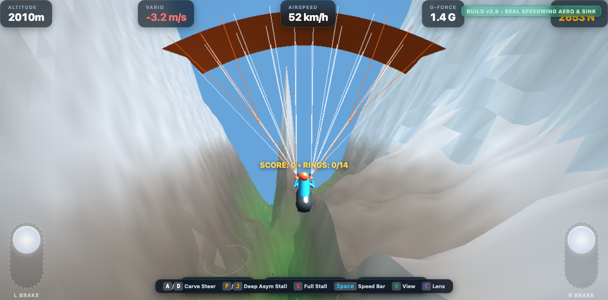
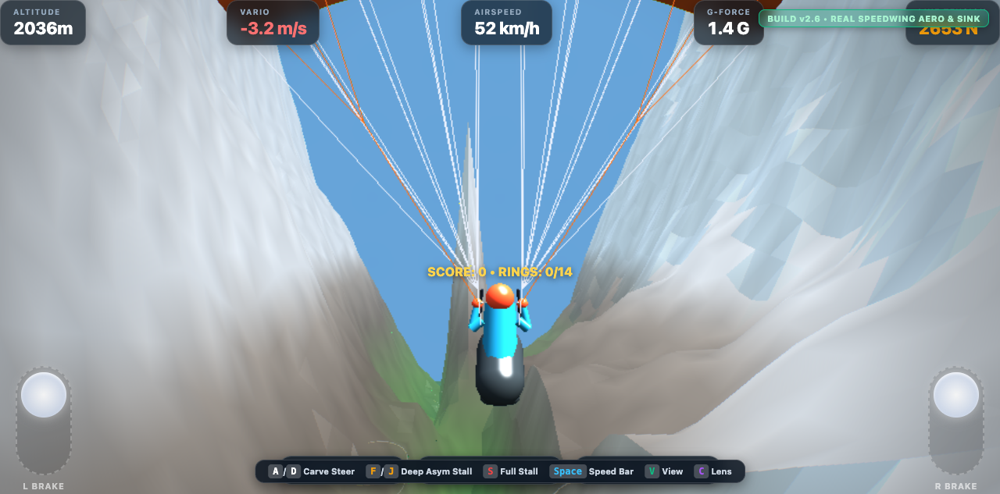
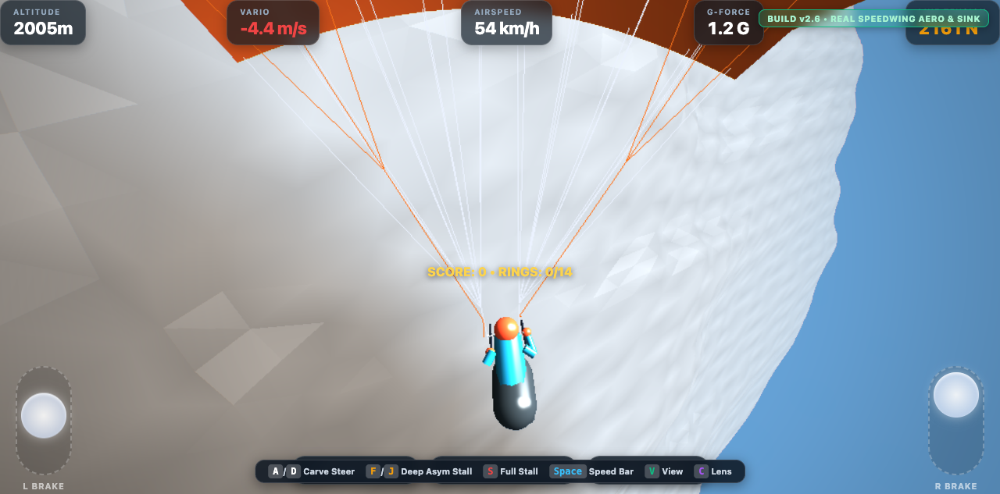
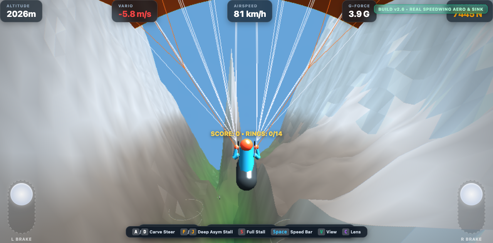
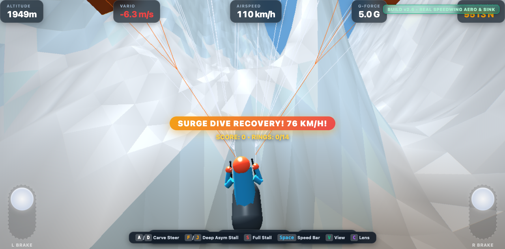
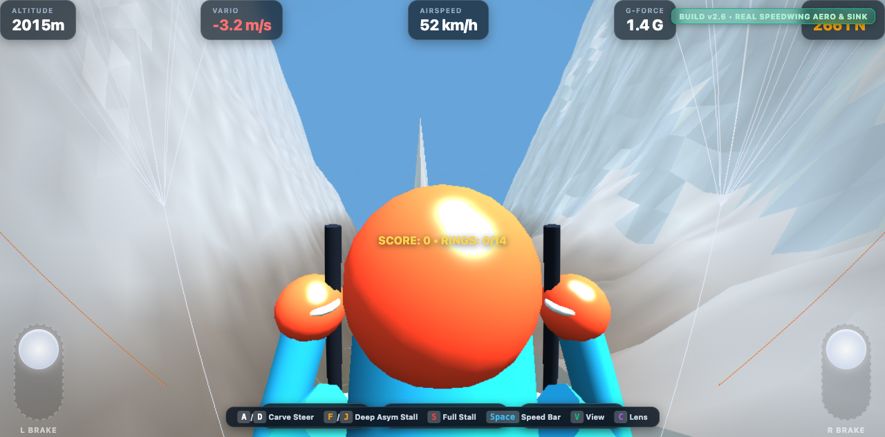

# Paraglide the World 🪂

<p align="center">
  <b>A real-world 3D paragliding simulator, acro-soaring adventure, and action flight game.</b><br>
  Built with Babylon.js, Cesium, TypeScript, and native Apple iOS integration.
</p>

<p align="center">
  
</p>

---

## 🌍 What is Paraglide the World?

**Paraglide the World** blends the physics-accurate aeromechanics of unpowered free flight with high-speed arcade adrenaline. Pilots launch over real-world photorealistic terrain and iconic global cityscapes, hunting rising thermals, carving along razor-sharp mountain ridges, boosting through tight urban corridors, and surviving high-stakes wipeouts.

Whether you want a peaceful cross-country soaring journey across the Swiss Alps or a heart-pounding race between downtown skyscrapers with rocket thrusters and friends, **Paraglide the World** delivers a modern, visceral flight experience.


---

## 📸 Gameplay & Visual Showcase

| High-Altitude Soaring | Banking Carve Turn |
|:---:|:---:|
|  |  |
| *Soaring over procedural mountain terrain with live variometer audio.* | *Deep weight-shift carve generating aerodynamic wingtip vapor.* |

| Speedbar Glide & Acceleration | Dynamic Stall & Aerodynamic Recovery |
|:---:|:---:|
|  |  |
| *Pushing the speed bar to flatten wing pitch and maximize groundspeed.* | *Asymmetric brake pull collapsing the canopy into an aerobatic tumble.* |

| Pilot Geometry & Pod Harness | Steampunk Glider Aesthetic |
|:---:|:---:|
|  |  |
| *Custom pilot geometry with teardrop speed helmet, visor, and flight harness.* | *Concept exploration: futuristic blue-hydrogen rocket-assisted paraglider.* |

---

## ✨ Key Features

### 🌐 Real-World 3D Planet & Global Metropolises
- **Keyless Global Satellite & Elevation**: Streams global high-resolution terrain tiles (AWS Terrarium) and satellite imagery (Esri World Imagery) without requiring proprietary API keys.
- **3D Urban Skylines**: Procedural and OpenFreeMap 3D building generation across iconic soaring destinations: **Toronto**, **New York**, **Paris**, **Rio de Janeiro**, **Rome**, **London**, and the **Great Pyramids of Giza**.

### 💨 Aeromechanical Pendulum Physics
- **Living Air Mass**: Real-time aerodynamic model simulating ridge lift, thermal updrafts, rotor sink, turbulent eddies, and dynamic wind gradients.
- **True Paraglider Mechanics**: Realistic wingtip deformation, weight-shift carving, riser line tension, speedbar pitch adjustment, full stalls, and spin recovery.
- **Spatial Audio Soundscape**: Dynamic 3D audio featuring relative wind rushing, canopy flutter, acoustic variometer beep tones for thermal climbs, and crunching crash impacts.

### 🚀 Steampunk Blue Hydrogen Jetpack & Acro Mechanics
- **Cryogenic Rocket Boost**: Twin brass-fitted cryogenic $H_2$ pressure spheres with glowing cyan cores, analog pressure gauges, and throttle-responsive blue plasma flame cones for powered speedruns and emergency altitude recovery.
- **Wingtip Vapor Vortices**: Dynamic contrails streaming from wingtips and thruster nozzles that scale in density, opacity, and length based on airspeed and G-force loading.

### 💥 "Hall of Meat" Wipeout Director
- **Rolling Trajectory Buffer**: Continuously records the last 4 seconds of flight telemetry.
- **Slow-Motion Replay (0.35x)**: Watch bone-crunching crashes with ragdoll pilot tumble physics and camera shake.
- **Broadcast Director Vantages**: Switch between 4 distinct crash angles:
  - 🎥 **Orbit Director**: Sweeping cinematic rotation around the impact point.
  - 📹 **CCTV Track**: Fixed-height urban surveillance zoom.
  - 🚶 **Bystander Camera**: Ground-level eyewitness perspective.
  - 🪂 **Pilot POV**: First-person tumbling perspective.

### 🦹 Wardrobe & Customization
- Choose between stylized pilot suits (*Cyber Neon*, *Aero Steampower*, *Liquid Gold*, *Acro Velocity*, *Carbon Phantom*), featuring iridescent visors, speed helmets, and matching wingtip smoke colors.

### 📱 First-Class Mobile & Native iOS Support
- **SwiftUI + WebKit Companion Shell**: Complete Xcode project in [`ios/ParaglideTheWorld.xcodeproj`](ios/ParaglideTheWorld.xcodeproj).
- **60 FPS CoreMotion Gyro**: Real device tilt and roll steering via Apple CoreMotion hardware sensors.
- **Apple Taptic Engine Integration**: Tactile haptic pulses for brake tension notches, thermal bumps, stall warnings, and impact shockwaves.

---

## 🕹️ Controls Guide

### ⌨️ Desktop (Keyboard & Mouse)

| Control | Action | Effect |
|:---|:---|:---|
| <kbd>A</kbd> / <kbd>D</kbd> | Weight Shift | Roll & lean to carve left or right |
| <kbd>F</kbd> | Left Brake | Pull left steering toggle to turn or flare |
| <kbd>J</kbd> | Right Brake | Pull right steering toggle to turn or flare |
| <kbd>F</kbd> + <kbd>J</kbd> | Dual Flare | Pull both brakes to bleed speed or flare for landing |
| <kbd>Space</kbd> | Speed Bar | Push speedbar to decrease angle of attack and accelerate |
| <kbd>C</kbd> | Camera Vantage | Cycle between Chase, Cockpit, Action Close, and Flyby |
| <kbd>R</kbd> | Respawn | Instantly respawn in clear air directly above your position |
| <kbd>Tab</kbd> | Tuning Lab | Toggle live aerodynamics HUD, G-forces, and wind telemetry |

### 📱 Mobile & Touch Controls

- **Left Screen Thumb**: Left brake strain & weight shift carve.
- **Right Screen Thumb**: Right brake strain & speedbar acceleration.
- **Hardware Gyroscope Tilt**: Physically tilt the device in landscape mode to roll and bank naturally.
- **Top Bar Controls**: Quick camera angle toggling and pause menu.

---

## 🏗️ Repository Architecture

```
paraglide-the-world/
├── apps/
│   └── web/                   # Core Game Engine (Babylon.js 3D + Cesium + Soundscape + Shaders)
│       ├── src/
│       │   ├── physics/       # Aerodynamics, pendulum math, thermal fields
│       │   ├── rendering/     # ParagliderRig, ActionCamera, WingtipTrails, CrashSystem
│       │   ├── world/         # GodsEyeGlobeEngine (3D terrain, Esri satellite, 3D buildings)
│       │   ├── progression/   # Pilot wardrobe skins & custom trail palettes
│       │   ├── audio/         # FlightSoundscape (wind, vario tones, thruster roar)
│       │   └── ui/            # Flight HUD, telemetry meters, wipeout director UI
├── packages/
│   └── world-data-engine/     # Live meteorological & real-world elevation engine
├── ios/
│   ├── ParaglideTheWorld/     # Native SwiftUI + WebKit iOS app shell
│   └── ParaglideTheWorld.xcodeproj # Xcode project (CoreMotion 60 FPS & Taptic Engine bridges)
├── Art direction/             # Visual style guides, character designs & concept art
├── docs/
│   ├── assets/                # Curated gameplay screenshots and art showcases
│   ├── game-design.md         # Game loop, progression, and design specifications
│   ├── physics-tuning-sheet.md# Flight mechanics constants & aerodynamic coefficients
│   └── technical-architecture.md# Rendering pipeline & system architecture
├── tools/                     # Automated flight physics test suites & Xcode project generator
└── Old, not used/             # Archived historical artifacts (Unreal 5, CADAM, old references)
```

---

## 🚀 Quick Start

### Prerequisites
- [Node.js](https://nodejs.org/) (v18 or higher)
- [pnpm](https://pnpm.io/) (`corepack enable pnpm`)

### 1. Web Simulator
```bash
# Clone the repository
git clone https://github.com/TylerSteeves/paraglide-the-world.git
cd paraglide-the-world

# Install dependencies
pnpm install

# Start development server
pnpm dev
```
Open **`http://localhost:5174/`** in your browser.

### 2. Production Build
```bash
pnpm build
```
Compiles both `@wilder-future/world-data-engine` and the client bundle in `apps/web/dist`.

### 3. Native iOS Deployment
```bash
# 1. Sync the latest web build into the iOS bundle
pnpm --filter paraglide-the-world-3d build
rm -rf ios/ParaglideTheWorld/dist
cp -R apps/web/dist ios/ParaglideTheWorld/dist

# 2. Open in Xcode
open ios/ParaglideTheWorld.xcodeproj
```
Select an iPhone Simulator or your connected iPhone and press **Cmd + R**.

---

## 📄 License
Private repository — All rights reserved © 2026 Tyler Steeves.
